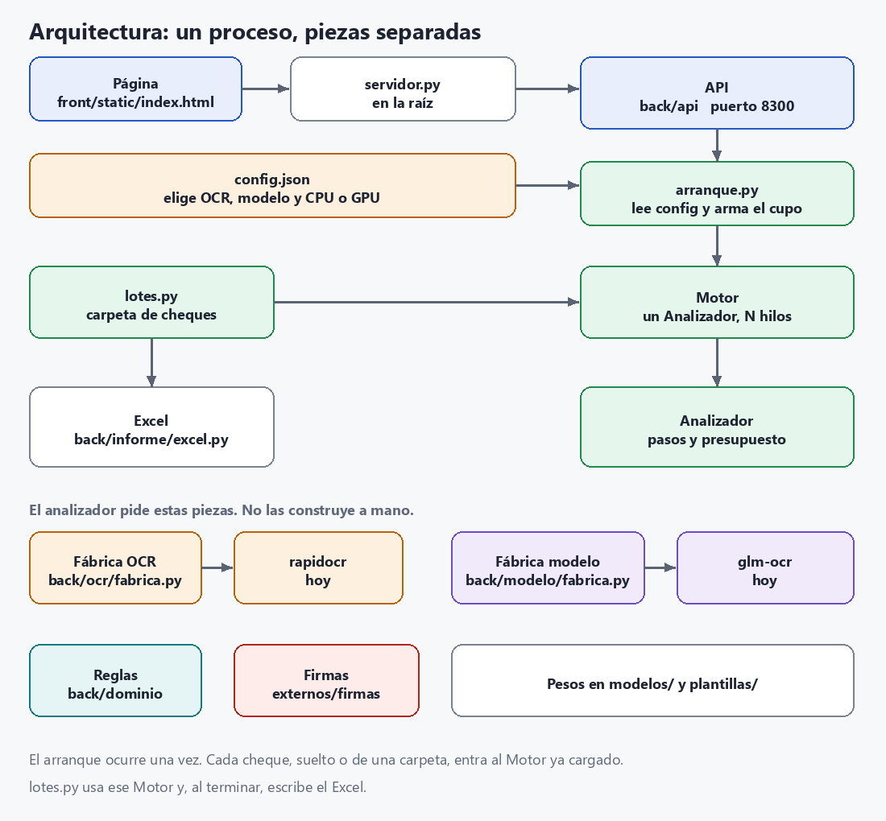

# Arquitectura de la PoC de lectura de cheques

Resumen de qué se usa y cómo interactúan las piezas al analizar el anverso de un cheque.
Todo corre en **un solo proceso local**, en CPU o en GPU NVIDIA con la misma instalación: no usa nube ni servicios externos.

## Estructura

El proceso sigue siendo uno solo, en este equipo. El código queda partido para que el OCR,
el modelo de letra y el Excel se puedan cambiar sin reescribir el análisis.

```
front/static/index.html     página (la sirve la API; no hay un segundo servidor)
back/api/                   FastAPI: subir un cheque, lotes, devolver el Excel
back/motor/                 orquesta un cheque o una carpeta
back/motor/memoria.py       con N>1, adelanta las imágenes en RAM
back/dominio/               reglas, MICR, CTC, comparación con verdad.csv
back/ocr/                   fábrica; hoy rapidocr/ (PP-OCR). El lector entrega ComponentesOcr
back/ocr/preproceso.py      versiones de cada zona (limpia, gris, escala)
back/modelo/glm_ocr.py      letra manuscrita; lo elige back/modelo/fabrica.py
back/informe/excel.py       los dos Excel (lote y evaluación)
externos/firmas/            detector de firmas
modelos/  plantillas/       pesos y la referencia MICR
```

`servidor.py`, `analizar.py`, `evaluar.py` y `descargar_modelos.py` siguen en la raíz:
son los mismos comandos de siempre y delegan en `back/`.



## Cambiar el OCR o el modelo

El analizador no importa RapidOCR ni GLM. Pide las piezas a una fábrica.

**Otro OCR ya registrado:** en `config.json` cambia `"motor_ocr"`.
**Otro modelo ya registrado:** cambia `"modelo_profundo"`. `"lectura_profunda": false` lo apaga.
**Un OCR nuevo:** una función `crear(config, gpu_onnx)` que devuelva `ComponentesOcr`
(`back/ocr/contrato.py`), una línea en `MOTORES` de `back/ocr/fabrica.py` y esa clave en `"motor_ocr"`.
**Un modelo nuevo:** un módulo con `estimar_segundos` y `leer`,
una línea en `MODELOS` de `back/modelo/fabrica.py` y esa clave en `"modelo_profundo"`.

Las reglas siguen leyendo la variante `"glm-ocr"`: es el nombre estable del resultado,
no el nombre del modelo. Un modelo nuevo no tiene que tocar `back/dominio/`.
El Excel no sabe de imágenes: si cambia el informe, el cambio queda en `back/informe/excel.py`.

## Qué se usa

| Pieza | Tecnología | Para qué | Tiempo aprox.* |
|---|---|---|---|
| Interfaz | `front/static/index.html` | Subir un cheque o una carpeta, ver resultados, Excel | — |
| API | FastAPI (`back/api/servidor.py`, arranque `servidor.py`) | Misma API local en el puerto 8300 | — |
| Orquestador | `back/motor/analizador.py` | Ejecuta los pasos, controla el presupuesto de tiempo, arma el JSON | — |
| Localizador de campos | **PP-OCRv6** vía `back/ocr/rapidocr/` | Encuentra cajas, etiquetas y la zona de cada campo | ~4,5–9 s |
| Clasificador por contenido | `back/dominio/clasificador.py` | Reubica campos según lo que dicen | <0,1 s |
| Detector de firmas | **YOLOS-tiny** — `externos/firmas/` | Borra la firma de los recortes; si tapa 2+ campos, marca ilegible | ~1,5 s |
| Lectura profunda | **GLM-OCR** vía `back/modelo/glm_ocr.py` | Lee la letra manuscrita. `"dudosos"` solo revisa lo que el camino rápido dejó pendiente | ~35 s |
| Lector rápido | **PP-OCRv6 small** — `back/ocr/rapidocr/lector.py` | Tres versiones de cada zona y la matriz de probabilidades | ~0,5 s por zona |
| Lector secundario | **PP-OCRv5 latin** | Otra opinión en zonas manuscritas | ~0,2 s por zona |
| Lector MICR | `back/dominio/micr.py` | Banda MICR carácter por carácter | milisegundos |
| Verificador CTC | `back/dominio/ctc.py` | Puntúa cada candidato contra la imagen | ~1 s en total |
| Reglas por campo | `back/dominio/` (`campos`, `parsers`, `reglas`, `nombres`) | Candidatos, cruce cifras/letras, fechas, ciudades, nombres | <0,5 s |
| Lotes y Excel | `back/motor/lotes.py` + `back/informe/excel.py` | Carpeta en segundo plano, acierto vs `verdad.csv`, Excel en `resultados/` | — |

\* Medido el 2026-10-08 con `muestras/pichincha_0001.tif` en una PC de 3 núcleos. Total: ~50 s por cheque. Sin GLM: ~10 s.

**Idea central:** ningún OCR se acepta "porque sí".
1. GLM, PP-OCR y el segundo lector solo **proponen** candidatos.
2. El verificador CTC mide qué tan bien encaja cada candidato con los trazos.
3. Las reglas cruzan fuentes: cifras con letras, MICR con lo impreso.
4. Un campo solo sale automático si gana con margen. Si no, queda en `revisar`.

## Diagrama de secuencia (un cheque)

El recorrido, con las zonas, las firmas y los dos modos del modelo, está dibujado en
[FUNCIONAMIENTO.md](FUNCIONAMIENTO.md). La misma figura:


Orden que ejecuta `back/motor/analizador.py`:

1. Abrir la imagen y llevarla a 592 px de ancho.
2. El OCR localiza las zonas por las etiquetas impresas.
3. El detector de firmas tapa la firma. Si una detección cubre dos campos o más, no se llama al modelo.
4. Con `lectura_profunda_modo` en `siempre`, el modelo lee antes beneficiario, monto en letras y ciudad/fecha.
5. MICR por plantillas E-13B. El OCR lee número, cuenta, montos, ciudad y beneficiario (tres versiones; en manuscrito también el lector secundario). Las reglas deciden.
6. Con el modo actual, `dudosos`, el modelo lee solo las zonas que quedaron en revisar, si cabe en el presupuesto. Esas zonas se vuelven a decidir sin releer el OCR.
7. La API dibuja las zonas y devuelve el JSON. La imagen subida no se guarda.

## Notas

- **Arranque:** al levantar se cargan todos los modelos y se analiza el cheque de referencia
  (`plantillas/`) como calentamiento. Por eso tarda 1,5–3,5 min.
- **Presupuesto de tiempo:** `config.json` → `presupuesto_segundos_por_lado`. Si un paso no
  alcanza, sus campos quedan "omitido / revisar" en lugar de pasarse del límite.
- **Selección:** `config.json` → `anverso` activa o desactiva cada grupo de campos.
  `lectura_profunda` activa GLM.
- **Lotes:** `POST /api/lotes` usa el mismo motor. Con 1, de a un cheque. Con N, N a la vez y `back/motor/memoria.py` deja los siguientes ya en RAM. El Excel sale al terminar, en el orden de la carpeta.
- **Ejecución** (`back/motor/hardware.py`, `arranque.py`, `paralelo.py`): al levantar se detecta CPU, RAM y
  GPU, se pregunta CPU/GPU y cuántos cheques a la vez. Se crea un `Analizador` (modelos cargados una vez) y
  `Motor` deja que hasta N hilos lo usen al mismo tiempo. Con N = 1 es un cheque por vez.
  Lo de cada cheque es local a la llamada. Con N > 1, torch reparte los núcleos (`set_num_threads(núcleos / N)`).

## Pendientes de optimización

- **GLM en segundo plano** (devolver primero el resultado rápido). Hecho: GLM solo para campos dudosos (`lectura_profunda_modo`).
- **GLM en int8** (`quantize_dynamic` u OpenVINO): las capas lineales son ~60 % de su tiempo.
- **Calentamiento corto al arrancar:** una imagen chica para GLM en lugar del análisis completo.
- **Descartados:**
  - Detector "tiny" o entrada más chica en el localizador: mueve las zonas.
  - Tiras de GLM de alto 40 o 32, o relleno ajustado al ancho: empeora la lectura manuscrita.
