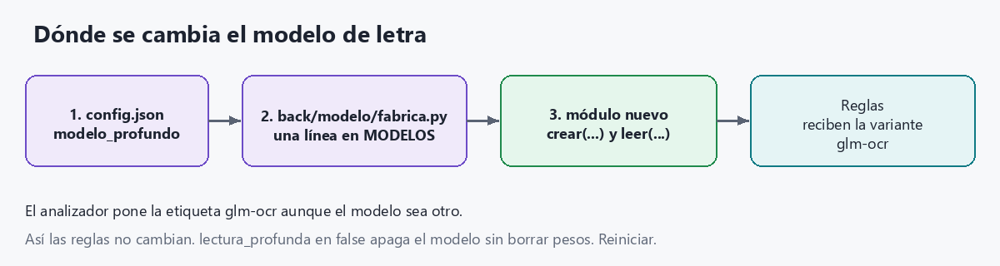

# Cómo levantar la PoC y cómo está armada

Lectura local del anverso de un cheque. No usa nube: OCR, modelo de letra, reglas y Excel corren en este equipo, en un solo proceso, en http://127.0.0.1:8300.

La paralelización sigue funcionando. La reestructuración separó OCR, modelo e informe; el cupo de cheques a la vez no se tocó.

## Requisitos

- Windows 10 u 11.
- Python 3.11 o superior (si falta, `instalar_y_levantar.bat` lo instala con winget).
- Unos 16 GB de RAM. El proceso usa cerca de 5 GB con los modelos cargados.
- Unos 10 GB de disco (torch con CUDA es grande; también corre en CPU si no hay GPU NVIDIA).
- Internet solo la primera vez, para bajar librerías y GLM-OCR (unos 2,5 GB).

## Primera vez

1. Abrir la carpeta del proyecto.
2. Doble clic en **`instalar_y_levantar.bat`**.

Ese archivo:

1. Comprueba Python 3.11.
2. Crea `.venv` e instala `requirements.txt` (torch CUDA 12.6 y `onnxruntime-gpu`; sin GPU, torch corre en CPU).
3. Ejecuta `descargar_modelos.py`: GLM-OCR en `modelos/GLM-OCR` y los ONNX de PaddleOCR / RapidOCR. El detector de firmas ya viene en `modelos/`.
4. Levanta la interfaz y abre el navegador.

La primera carga de modelos tarda entre 1 y 3 minutos. La consola pregunta (si hay GPU) CPU o GPU, qué GPU si hay más de una, y cuántos cheques a la vez. Enter deja el valor recomendado.

Cuando aparezca `Abrir http://127.0.0.1:8300`, el navegador abre esa dirección. Para apagar, cerrar la ventana de la consola.

## Las veces siguientes

Doble clic en **`iniciar.bat`**. No reinstala nada: vuelve a preguntar CPU/GPU y paralelismo, carga los modelos y abre el navegador.

Si el puerto 8300 ya está ocupado, `instalar_y_levantar.bat` cierra el proceso anterior antes de levantar. `iniciar.bat` no lo hace: hay que cerrar la consola vieja.

## Sin preguntas (misma máquina, mismos modelos)

Desde la carpeta del proyecto:

```bat
.venv\Scripts\python servidor.py --sin-preguntar
```

Usa `config.json` → `ejecucion` (`dispositivo`, `paralelos`, `gpu`, `precision_gpu`).

Para fijarlo en la línea de comandos:

```bat
.venv\Scripts\python servidor.py --dispositivo cpu --paralelos 1
.venv\Scripts\python servidor.py --dispositivo gpu --paralelos 3 --gpu 0
.venv\Scripts\python servidor.py --abrir-navegador
```

Diagnóstico del equipo, sin cargar modelos:

```bat
.venv\Scripts\python -m back.motor.hardware
```

## Usar la interfaz

La página está en `front/static/index.html`. La sirve la API; no hay un segundo servidor.

**Un cheque.** Arrastrar un TIF, PNG o JPG, marcar qué campos analizar y pulsar Analizar. La imagen no se guarda. El resultado muestra campos, si hay que revisar, tiempos y el cheque con las zonas (verde si se aceptó, naranja si queda en revisar).

**Una carpeta.** Pestaña Carpeta, pegar la ruta del Explorador de Windows. Opcional: incluir subcarpetas. Se leen `.tif`, `.tiff`, `.png`, `.jpg` y `.jpeg`. El avance se consulta en vivo. Al terminar se puede descargar el Excel; también queda en `resultados/lote_*.xlsx`. Si la carpeta trae `verdad.csv`, la pantalla y el Excel miden el acierto por campo.

La selección de la izquierda sale de `config.json` → `anverso` y se puede cambiar en cada análisis:

| Clave | Qué lee |
|---|---|
| `micr_cheque_cuenta_banco` | Banda MICR, número de cheque, cuenta y banco |
| `montos` | Cifras y letras, cruzadas |
| `ciudad_fecha` | Ciudad y fecha |
| `beneficiario` | Nombre, con diccionario |

`presupuesto_segundos_por_lado` (60) es un tope. Si un paso no alcanza, ese campo queda en revisar en lugar de pasarse del límite.

## Línea de comandos (sin abrir el navegador)

```bat
.venv\Scripts\python analizar.py ruta\al\cheque.tif
.venv\Scripts\python analizar.py ruta\al\cheque.tif --beneficiario
.venv\Scripts\python evaluar.py carpeta_con_verdad.csv
.venv\Scripts\python generar_variaciones.py cheque.tif carpeta_salida
```

`evaluar.py` compara contra `verdad.csv` de esa carpeta y escribe `resultados/evaluacion_*.xlsx`.

`analizar.py` y `evaluar.py` cargan los modelos ellos mismos. No pasan por el cupo de hilos del servidor: analizan de a un cheque. El paralelismo de varios cheques a la vez es el de la interfaz (un cheque suelto o una carpeta).

## Arquitectura actual

Hay un solo proceso. La página pide. La API recibe. El motor ordena los pasos. El OCR, el modelo de letra y el Excel son piezas aparte: el analizador no las construye a mano, se las pide a una fábrica según `config.json`.


`arranque` corre al abrir el programa, no en cada cheque. Cada análisis entra por `Motor` y de ahí al mismo `Analizador`.

| Carpeta | Responsabilidad |
|---|---|
| `front/static/` | Página. No conoce modelos. |
| `servidor.py` | Arranque. Delega en `back/api`. |
| `back/api/` | Recibe la imagen o la ruta, dibuja zonas y devuelve JSON o Excel. |
| `back/motor/` | Presupuesto de tiempo, hilos, lotes y cola en RAM (`memoria.py`). |
| `back/dominio/` | Decide OK o revisar. No sabe qué OCR ni qué modelo produjo el texto. |
| `back/ocr/` | Contrato y fábrica del OCR. Hoy `rapidocr` (PP-OCRv6 small y, de segundo, PP-OCRv5 latin). |
| `back/modelo/` | Fábrica de la letra manuscrita. Hoy `glm-ocr` (`glm_ocr.py`). |
| `back/informe/` | Excel del lote y Excel de la evaluación. |
| `externos/firmas/` | Detector de firmas. |
| `modelos/`, `plantillas/` | Pesos y la referencia MICR. |

## Cómo funciona un cheque

El orden de abajo es el de `back/motor/analizador.py`. El OCR localiza primero. La lectura de cada recorte ocurre dentro de cada campo, junto con las reglas. El modelo de letra entra antes o después según `lectura_profunda_modo`.


Ninguna lectura se acepta solo porque el OCR o el modelo la propuso. Las reglas cruzan cifras con letras, la fecha con el calendario y el texto con la matriz de probabilidades (CTC). Si no hay margen claro, el campo sale en revisar.

Detalle de esos pasos:

1. Abrir la imagen y llevarla a 592 px de ancho (`back/dominio/imagen.py`).
2. El OCR busca etiquetas impresas ("Páguese a", "La suma de", "US$", …) y arma la zona de cada campo.
3. El detector de firmas borra la firma de los recortes. Si una detección tapa dos o más campos manuscritos, esa letra se marca ilegible y no se llama al modelo.
4. Si `lectura_profunda_modo` es `siempre`, el modelo lee antes todas las zonas manuscritas que estén activas.
5. MICR por plantillas E-13B, y el OCR en el número de cheque y la cuenta impresos. Luego montos, ciudad/fecha y beneficiario: tres versiones de cada zona, y en manuscrito también el lector secundario.
6. Con el modo actual, `dudosos`, el modelo solo lee las zonas que quedaron en revisar, y solo si cabe en los 60 s. Esas zonas se vuelven a decidir con el texto nuevo, sin releer la imagen con el OCR.
7. La API dibuja las zonas y responde. La imagen subida no se guarda.

## Paralelización

Sigue activa. Los modelos se cargan una vez en `back/motor/paralelo.py`. En una carpeta, `back/motor/lotes.py` y `back/motor/memoria.py` adelantan las imágenes en RAM cuando hay más de un cheque a la vez.


Al levantar se crea un `Analizador`. El OCR, el modelo, el detector de firmas y las plantillas MICR quedan cargados ahí y se comparten.

`Motor` tiene un semáforo con el número elegido al iniciar (`paralelos`). Hasta ese número de cheques entran a la vez, cada uno en su hilo. La imagen de trabajo de cada cheque es local al hilo, así que dos cheques no se mezclan. Con `paralelos` en 1 el siguiente espera: es el modo de un cheque por vez.

En una carpeta:

- Con 1, los cheques van en orden, de a uno, leyendo el disco en el momento del análisis.
- Con N, N hilos llaman al mismo `Motor`. Otro hilo va llenando una cola en RAM con los siguientes cheques ya decodificados (la misma lectura en gris de siempre). La CPU o la GPU reciben la imagen desde memoria y no esperan al disco. La precisión no se toca: no se pasa a float16 ni se cambia el modelo. La cola usa hasta la mitad de la RAM que sobre, con un tope de 2 GB, y suelta cada imagen en cuanto un hilo la toma. El Excel se escribe al terminar, en el orden de la carpeta, aunque los hilos acaben desordenados.

No se duplican los pesos. Cada cheque extra suma memoria de trabajo (cerca de 0,8 GB de RAM y, en GPU, cerca de 0,6 GB de VRAM). El tope que muestra la consola es el menor entre RAM libre, núcleos y VRAM.

- En CPU, varios a la vez reparten los núcleos. Un cheque suelto no sale más rápido. Una carpeta sí avanza más cheques por minuto. Si un paso no entra en los 60 s, ese campo queda en revisar.
- En GPU, un solo cheque ya baja el tiempo del modelo. Con varios, mientras uno usa la GPU los otros siguen con recorte, reglas y MICR.

La pregunta al iniciar es la forma normal de elegir el número. También vale:

```bat
.venv\Scripts\python servidor.py --dispositivo cpu --paralelos 2
.venv\Scripts\python servidor.py --sin-preguntar
```

En `config.json`, `ejecucion.paralelos` se usa con `--sin-preguntar` o cuando la consola no es interactiva. Con `iniciar.bat` la consola pregunta, y Enter deja el recomendado (en un CPU de 4 núcleos, 1).

Un OCR o un modelo nuevo lo usan los mismos hilos. Para que N mayor que 1 siga siendo seguro, ese motor tiene que aceptar varias inferencias a la vez sobre la misma instancia, como hacen hoy ONNX Runtime y torch. El cupo, las reglas y el Excel no se duplican.

Hay que reiniciar el programa después de cualquier cambio de OCR o de modelo: los pesos se cargan al arrancar.

## Cambiar el OCR

Hoy `config.json` tiene `"motor_ocr": "rapidocr"`. El analizador llama a `back/ocr/fabrica.py` y esa fábrica abre el módulo registrado.


### Solo otra variante del OCR actual

PP-OCR ya admite estos nombres en `modelo_lectura` y `lector_secundario`: `v6_small`, `v6_medium`, `v5_latin`, `v5_server`. El detector admite `small` o `tiny`.

En `config.json`:

```json
"motor_ocr": "rapidocr",
"modelo_lectura": "v6_medium",
"detector": "small",
"lector_secundario": "v5_latin"
```

`"lector_secundario": null` apaga la segunda opinión. No hace falta tocar Python. Reiniciar.

Esas tres claves las lee RapidOCR. Un motor distinto puede ignorarlas y leer las suyas.

### Un OCR distinto

Se tocan tres sitios. No se tocan el analizador, las reglas, la API, los lotes ni el Excel.

1. Crear el módulo, por ejemplo `back/ocr/mi_ocr/componentes.py`, con una función `crear(config, gpu_onnx)` que devuelva `ComponentesOcr`:

```python
from back.ocr.contrato import ComponentesOcr

def crear(config, gpu_onnx):
    return ComponentesOcr(
        lector=MiLector(config),
        localizador=MiLocalizador(config),
        lector_secundario=None,
    )

def preparar_descarga(config):
    # Opcional. descargar_modelos.py lo llama si existe.
    print("Pesos del OCR listos.")
```

El lector necesita:

- `modelo`: texto corto. La pantalla lo muestra como nombre del modelo.
- `caracteres`: alfabeto. El índice 0 es el blanco del CTC.
- `leer_con_probabilidades(imagenes, variantes, con_matriz=())`.
  - `imagenes` es `{variante: imagen gris}` con las claves `limpio_x3`, `gris_x3` y `limpio_x2`. Esas versiones las prepara `back/ocr/preproceso.py` antes de llamar al OCR.
  - Devuelve `(lecturas, matrices)`.
  - `lecturas` es una lista de `{variante, texto, confianza}` en el mismo orden.
  - `matrices` es `{variante: ndarray de forma T x C}` solo para las variantes pedidas en `con_matriz`. Las columnas siguen el orden de `caracteres`.

El localizador necesita:

- `preparar(gris)` devolviendo la imagen de `back.dominio.imagen.preparar_imagen` (ancho 592). La página dibuja las zonas sobre esa imagen.
- `localizar(imagen)` devolviendo `(zonas, cajas, info)`.
  - `zonas`: nombre hacia `(x0, y0, x1, y1)` en píxeles de esa imagen. Los nombres que ya usa el análisis son `beneficiario`, `monto_numeros`, `monto_letras`, `monto_letras_2`, `ciudad_fecha`, `cheque_impreso`, `cuenta_impresa` y `micr`.
  - `info` incluye `banco_impreso`, `notas`, `impresos`, `fuente_zonas`, `etiquetas` y `cajas`.

2. Registrar una línea en `MOTORES` de `back/ocr/fabrica.py`:

```python
MOTORES = {
    "rapidocr": "back.ocr.rapidocr.componentes:crear_rapidocr",
    "mi_ocr": "back.ocr.mi_ocr.componentes:crear",
}
```

La forma es `"paquete.modulo:funcion"`.

3. Activarlo en `config.json` y reiniciar:

```json
"motor_ocr": "mi_ocr"
```

`descargar_modelos.py` llama a `preparar_descarga` del módulo activo. Si el OCR nuevo baja pesos, esa función es el lugar. Si no existe, el script avisa y sigue.

Si `motor_ocr` no está en `MOTORES`, el arranque se detiene con la lista de motores registrados.

### Ejemplo: poner TrOCR en lugar del lector actual

Este código no está en el proyecto y no está registrado. El OCR que corre hoy sigue siendo RapidOCR. El ejemplo muestra los tres toques si el lector de cada recorte pasara a ser TrOCR (`microsoft/trocr-base-handwritten` o la carpeta local equivalente).

TrOCR lee una línea ya recortada. No busca las cajas del cheque. Por eso el ejemplo deja el localizador de RapidOCR (las zonas no se mueven) y solo cambia el lector. TrOCR devuelve texto. No devuelve la matriz CTC de PP-OCR. Las reglas actuales puntúan los candidatos contra esa matriz. En un cambio real hay que construir una matriz `T x C` alineada con `caracteres`, o las decisiones de OK y revisar dejan de ser las de ahora. La matriz del ejemplo es un relleno para cumplir la firma de la función. No sirve para puntuar.

1. Crear `back/ocr/trocr/componentes.py`:

```python
"""Ejemplo de adaptador TrOCR. No está registrado en la fábrica."""

import numpy as np

from back.ocr.contrato import ComponentesOcr
from back.ocr.rapidocr.lector import params_onnx
from back.ocr.rapidocr.localizador import Localizador


class LectorTrOCR:
    def __init__(self, carpeta, dispositivo):
        import torch
        from transformers import TrOCRProcessor, VisionEncoderDecoderModel
        self.modelo = "trocr"
        self.dispositivo = dispositivo
        self.torch = torch
        self.proc = TrOCRProcessor.from_pretrained(carpeta)
        self.red = VisionEncoderDecoderModel.from_pretrained(carpeta).eval()
        if dispositivo != "cpu":
            self.red = self.red.to(dispositivo)
        # Índice 0 = blanco CTC. Un TrOCR real tiene que usar el alfabeto
        # con el que se arme la matriz; esta lista solo ilustra la forma.
        self._caracteres = ["", *"abcdefghijklmnopqrstuvwxyz0123456789$.,/- "]

    @property
    def caracteres(self):
        return self._caracteres

    def leer_con_probabilidades(self, imagenes, variantes, con_matriz=()):
        lecturas, matrices = [], {}
        for variante in variantes:
            texto = self._leer_una(imagenes[variante])
            lecturas.append({"variante": variante, "texto": texto, "confianza": 0.99})
            if variante in con_matriz:
                # Relleno de ejemplo, no es la probabilidad de PP-OCR.
                matrices[variante] = np.full((8, len(self._caracteres)), 1 / len(self._caracteres))
        return lecturas, matrices

    def _leer_una(self, gris):
        from PIL import Image
        imagen = Image.fromarray(gris).convert("RGB")
        pixeles = self.proc(images=imagen, return_tensors="pt").pixel_values
        if self.dispositivo != "cpu":
            pixeles = pixeles.to(self.dispositivo)
        with self.torch.inference_mode():
            ids = self.red.generate(pixeles, max_new_tokens=64)
        return self.proc.batch_decode(ids, skip_special_tokens=True)[0].strip()


def crear(config, gpu_onnx):
    dispositivo = f"cuda:{gpu_onnx}" if gpu_onnx is not None else "cpu"
    carpeta = config.get("carpeta_ocr", "modelos/trocr-handwritten")
    onnx = params_onnx(None, gpu_onnx)
    return ComponentesOcr(
        lector=LectorTrOCR(carpeta, dispositivo),
        localizador=Localizador(config.get("modelo_lectura", "v6_small"), config.get("detector", "small"), onnx),
        lector_secundario=None,
    )


def preparar_descarga(config):
    print("Ejemplo: aquí se bajarían los pesos de TrOCR a modelos/trocr-handwritten.")
```

2. Una línea en `MOTORES` de `back/ocr/fabrica.py`:

```python
MOTORES = {
    "rapidocr": "back.ocr.rapidocr.componentes:crear_rapidocr",
    "trocr": "back.ocr.trocr.componentes:crear",
}
```

3. En `config.json`, y reiniciar:

```json
"motor_ocr": "trocr",
"carpeta_ocr": "modelos/trocr-handwritten",
"detector": "small",
"modelo_lectura": "v6_small"
```

`detector` y `modelo_lectura` siguen siendo del localizador RapidOCR. `carpeta_ocr` es la carpeta de pesos de TrOCR. Para volver al comportamiento actual basta con `"motor_ocr": "rapidocr"`.

## Cambiar el modelo de letra

Hoy `config.json` tiene `"modelo_profundo": "glm-ocr"` y `"lectura_profunda": true`. El analizador llama a `back/modelo/fabrica.py`. Si `lectura_profunda` es `false`, no carga ningún modelo y el cheque se resuelve solo con el OCR y las reglas.



El texto del modelo entra como una lectura más. El analizador le pone la variante `glm-ocr` aunque el modelo no sea GLM. Las reglas ya buscan esa variante. Un modelo nuevo no tiene que modificar `back/dominio/`.

### Apagarlo o apuntar a otra carpeta del mismo GLM

```json
"lectura_profunda": false
```

O, para otros pesos GLM ya descargados:

```json
"modelo_profundo": "glm-ocr",
"carpeta_modelo_profundo": "modelos/GLM-OCR"
```

`lectura_profunda_modo` sigue en `dudosos` o pasa a `siempre`. No hace falta tocar Python. Reiniciar.

### Un modelo distinto

Se tocan tres sitios. No se tocan el analizador, las reglas, el OCR ni el Excel.

1. Crear el módulo, por ejemplo `back/modelo/mi_modelo.py`:

```python
class MiLector:
    def estimar_segundos(self, n_renglones):
        return 2.0 + 0.3 * n_renglones

    def leer(self, recortes):
        # recortes: lista de (nombre_de_zona, imagen gris)
        textos = {}
        for nombre, imagen in recortes:
            textos[nombre] = "texto leido de esa zona"
        textos["_texto_completo"] = "\n".join(textos.values())
        return textos

def crear(config, raiz, dispositivo, precision):
    # dispositivo es "cpu" o "cuda:0". precision es "float32" o "float16".
    return MiLector()

def descargar(config, raiz):
    # Opcional. descargar_modelos.py lo llama si existe.
    print("Pesos del modelo listos.")
```

`estimar_segundos` sirve para no pasarse de los 60 s: si no alcanza, el analizador omite el modelo y deja el campo en revisar.

`leer` recibe las zonas en este orden posible: `beneficiario`, `monto_letras`, `ciudad_fecha`. Devuelve `{nombre_de_zona: texto}`. `_texto_completo` es opcional: el analizador lo saca del diccionario y lo guarda en el JSON.

2. Registrar una línea en `MODELOS` de `back/modelo/fabrica.py`:

```python
MODELOS = {
    "glm-ocr": "back.modelo.glm_ocr:crear",
    "mi_modelo": "back.modelo.mi_modelo:crear",
}
```

3. Activarlo en `config.json` y reiniciar:

```json
"lectura_profunda": true,
"lectura_profunda_modo": "dudosos",
"modelo_profundo": "mi_modelo"
```

Si el módulo no define `descargar`, `descargar_modelos.py` avisa y no baja nada. Si `modelo_profundo` no está en `MODELOS`, el arranque se detiene con la lista de modelos registrados.

La carpeta `carpeta_modelo_profundo` la usa GLM. Un modelo nuevo puede leer esa clave u otra que agregue en `config.json`; la fábrica le pasa el `config` completo a `crear`.

### Ejemplo: cambiar GLM por otro modelo de letra

Este código tampoco está en el proyecto. GLM sigue siendo el modelo activo. El ejemplo es un segundo modelo, llamado `otro-modelo`, que lee cada recorte por su cuenta y devuelve el texto de la zona. El analizador le pone la variante `glm-ocr` antes de llamar a las reglas, así que `back/dominio/` no se toca.

1. Crear `back/modelo/otro_modelo.py`:

```python
"""Ejemplo de otro modelo de letra. No está registrado en la fábrica."""

from pathlib import Path


class LectorOtro:
    def __init__(self, carpeta, dispositivo, precision):
        import torch
        from transformers import AutoModelForImageTextToText, AutoProcessor
        self.torch = torch
        self.dispositivo = dispositivo
        self.gpu = str(dispositivo).startswith("cuda")
        self.dtype = getattr(torch, precision) if self.gpu else torch.float32
        self.proc = AutoProcessor.from_pretrained(carpeta)
        self.red = AutoModelForImageTextToText.from_pretrained(carpeta, dtype=self.dtype).eval()
        if self.gpu:
            self.red = self.red.to(dispositivo)
        self.segundos_por_token = 0.05 if self.gpu else 0.35

    def estimar_segundos(self, n_renglones):
        return 2.0 + self.segundos_por_token * 12 * n_renglones

    def leer(self, recortes):
        """recortes: lista de (nombre_de_zona, imagen gris)."""
        from PIL import Image
        textos = {}
        for nombre, gris in recortes:
            imagen = Image.fromarray(gris).convert("RGB")
            mensajes = [{"role": "user", "content": [
                {"type": "image", "image": imagen},
                {"type": "text", "text": "Text Recognition:"},
            ]}]
            entrada = self.proc.apply_chat_template(
                mensajes, tokenize=True, add_generation_prompt=True,
                return_dict=True, return_tensors="pt")
            if self.gpu:
                entrada = entrada.to(self.dispositivo)
            with self.torch.inference_mode():
                salida = self.red.generate(**entrada, max_new_tokens=32, do_sample=False)
            nuevos = salida[0][entrada["input_ids"].shape[1]:]
            textos[nombre] = " ".join(self.proc.decode(nuevos, skip_special_tokens=True).split())
        textos["_texto_completo"] = "\n".join(
            textos[nombre] for nombre, _ in recortes if nombre in textos)
        return textos


def _carpeta(config, raiz):
    carpeta = Path(config.get("carpeta_modelo_profundo", "modelos/OTRO-MODELO"))
    if not carpeta.is_absolute():
        carpeta = Path(raiz) / carpeta
    return carpeta


def crear(config, raiz, dispositivo, precision):
    return LectorOtro(str(_carpeta(config, raiz)), dispositivo, precision)


def descargar(config, raiz):
    carpeta = _carpeta(config, raiz)
    if (carpeta / "model.safetensors").exists():
        print("Otro modelo ya está descargado.")
        return
    print("Ejemplo: aquí se bajarían los pesos a", carpeta)
```

Ese `leer` no apila las tiras como GLM. El contrato solo pide un texto por zona. Si el modelo nuevo lee mejor con las zonas apiladas en una sola imagen, esa preparación va dentro de `leer`, igual que hoy en `back/modelo/glm_ocr.py`.

2. Una línea en `MODELOS` de `back/modelo/fabrica.py`:

```python
MODELOS = {
    "glm-ocr": "back.modelo.glm_ocr:crear",
    "otro-modelo": "back.modelo.otro_modelo:crear",
}
```

3. En `config.json`, y reiniciar:

```json
"lectura_profunda": true,
"lectura_profunda_modo": "dudosos",
"modelo_profundo": "otro-modelo",
"carpeta_modelo_profundo": "modelos/OTRO-MODELO"
```

Para volver a GLM:

```json
"modelo_profundo": "glm-ocr",
"carpeta_modelo_profundo": "modelos/GLM-OCR"
```

OCR y modelo se cambian por separado. Se puede dejar RapidOCR y cambiar solo el modelo, o dejar GLM y cambiar solo el lector a TrOCR. El analizador, las reglas y el Excel quedan igual.
