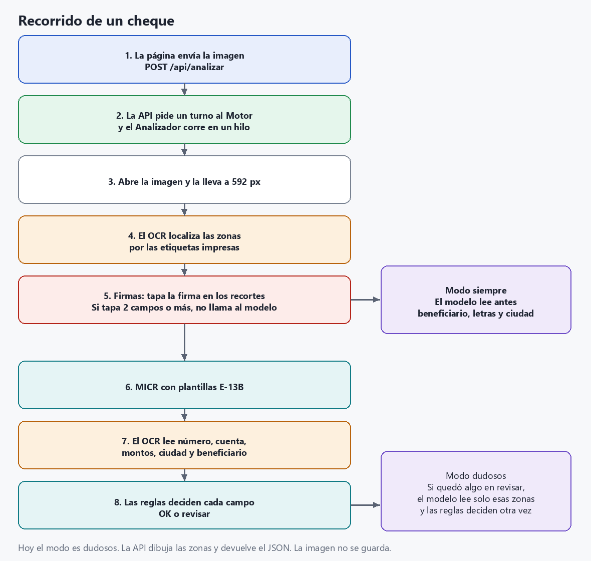
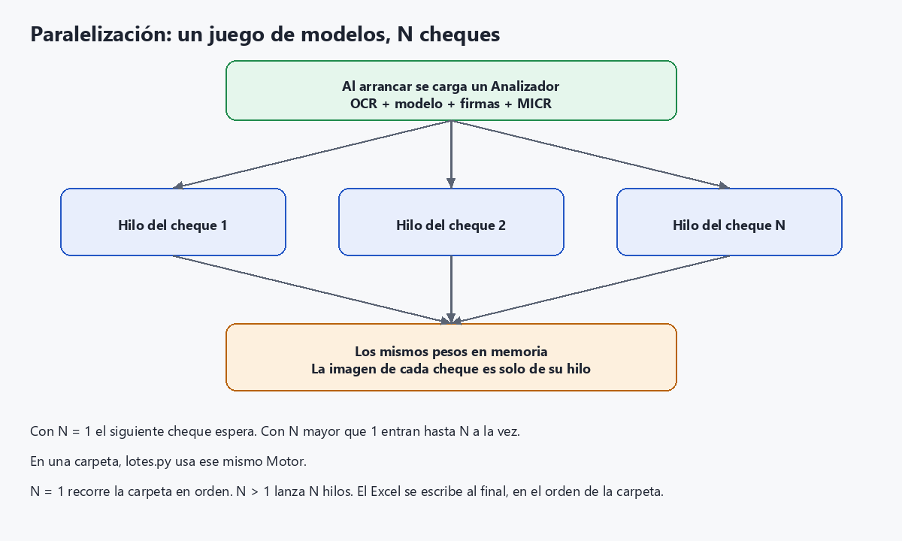
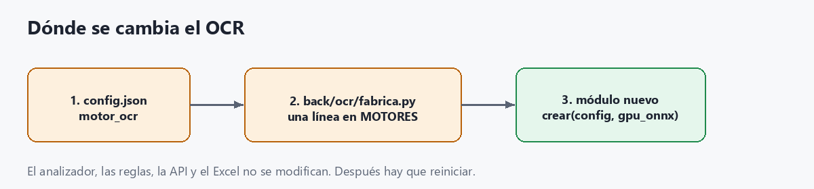

# Cómo levantar la PoC y cómo está armada

Lectura local del anverso de un cheque. No usa nube: OCR, modelo de letra, reglas y Excel corren en este equipo, en un solo proceso, en http://127.0.0.1:8300.

La paralelización sigue funcionando. La reestructuración separó OCR, modelo e informe; el cupo de cheques a la vez no se tocó.

## Requisitos

- Windows 10 u 11.
- Python 3.11 o superior (si falta, `instalar_y_levantar.bat` lo instala con winget).
- Unos 16 GB de RAM. El proceso usa cerca de 5 GB con los modelos cargados.
- Unos 10 GB de disco (torch con CUDA es grande; también corre en CPU si no hay GPU NVIDIA).
- Internet solo la primera vez, para bajar librerías y GLM-OCR (unos 2,5 GB).

## Primera vez

1. Abrir la carpeta del proyecto.
2. Doble clic en **`instalar_y_levantar.bat`**.

Ese archivo:

1. Comprueba Python 3.11.
2. Crea `.venv` e instala `requirements.txt` (torch CUDA 12.6 y `onnxruntime-gpu`; sin GPU, torch corre en CPU).
3. Ejecuta `descargar_modelos.py`: GLM-OCR en `modelos/GLM-OCR` y los ONNX de PaddleOCR / RapidOCR. El detector de firmas ya viene en `modelos/`.
4. Levanta la interfaz y abre el navegador.

La primera carga de modelos tarda entre 1 y 3 minutos. La consola pregunta (si hay GPU) CPU o GPU, qué GPU si hay más de una, y cuántos cheques a la vez. Enter deja el valor recomendado.

Cuando aparezca `Abrir http://127.0.0.1:8300`, el navegador abre esa dirección. Para apagar, cerrar la ventana de la consola.

## Las veces siguientes

Doble clic en **`iniciar.bat`**. No reinstala nada: vuelve a preguntar CPU/GPU y paralelismo, carga los modelos y abre el navegador.

Si el puerto 8300 ya está ocupado, `instalar_y_levantar.bat` cierra el proceso anterior antes de levantar. `iniciar.bat` no lo hace: hay que cerrar la consola vieja.

## Sin preguntas (misma máquina, mismos modelos)

Desde la carpeta del proyecto:

```bat
.venv\Scripts\python servidor.py --sin-preguntar
```

Usa `config.json` → `ejecucion` (`dispositivo`, `paralelos`, `gpu`, `precision_gpu`).

Para fijarlo en la línea de comandos:

```bat
.venv\Scripts\python servidor.py --dispositivo cpu --paralelos 1
.venv\Scripts\python servidor.py --dispositivo gpu --paralelos 3 --gpu 0
.venv\Scripts\python servidor.py --abrir-navegador
```

Diagnóstico del equipo, sin cargar modelos:

```bat
.venv\Scripts\python -m back.motor.hardware
```

## Usar la interfaz

La página está en `front/static/index.html`. La sirve la API; no hay un segundo servidor.

**Un cheque.** Arrastrar un TIF, PNG o JPG, marcar qué campos analizar y pulsar Analizar. La imagen no se guarda. El resultado muestra campos, si hay que revisar, tiempos y el cheque con las zonas (verde si se aceptó, naranja si queda en revisar).

**Una carpeta.** Pestaña Carpeta, pegar la ruta del Explorador de Windows. Opcional: incluir subcarpetas. Se leen `.tif`, `.tiff`, `.png`, `.jpg` y `.jpeg`. El avance se consulta en vivo. Al terminar se puede descargar el Excel; también queda en `resultados/lote_*.xlsx`. Si la carpeta trae `verdad.csv`, la pantalla y el Excel miden el acierto por campo.

La selección de la izquierda sale de `config.json` → `anverso` y se puede cambiar en cada análisis:

| Clave | Qué lee |
|---|---|
| `micr_cheque_cuenta_banco` | Banda MICR, número de cheque, cuenta y banco |
| `montos` | Cifras y letras, cruzadas |
| `ciudad_fecha` | Ciudad y fecha |
| `beneficiario` | Nombre, con diccionario |

`presupuesto_segundos_por_lado` (60) es un tope. Si un paso no alcanza, ese campo queda en revisar en lugar de pasarse del límite.

## Línea de comandos (sin abrir el navegador)

```bat
.venv\Scripts\python analizar.py ruta\al\cheque.tif
.venv\Scripts\python analizar.py ruta\al\cheque.tif --beneficiario
.venv\Scripts\python evaluar.py carpeta_con_verdad.csv
.venv\Scripts\python generar_variaciones.py cheque.tif carpeta_salida
```

`evaluar.py` compara contra `verdad.csv` de esa carpeta y escribe `resultados/evaluacion_*.xlsx`.

`analizar.py` y `evaluar.py` cargan los modelos ellos mismos. No pasan por el cupo de hilos del servidor: analizan de a un cheque. El paralelismo de varios cheques a la vez es el de la interfaz (un cheque suelto o una carpeta).

## Arquitectura actual

Hay un solo proceso. La página pide. La API recibe. El motor ordena los pasos. El OCR, el modelo de letra y el Excel son piezas aparte: el analizador no las construye a mano, se las pide a una fábrica según `config.json`.


`arranque` corre al abrir el programa, no en cada cheque. Cada análisis entra por `Motor` y de ahí al mismo `Analizador`.

| Carpeta | Responsabilidad |
|---|---|
| `front/static/` | Página. No conoce modelos. |
| `servidor.py` | Arranque. Delega en `back/api`. |
| `back/api/` | Recibe la imagen o la ruta, dibuja zonas y devuelve JSON o Excel. |
| `back/motor/` | Presupuesto de tiempo, hilos y lotes. |
| `back/dominio/` | Decide OK o revisar. No sabe qué OCR ni qué modelo produjo el texto. |
| `back/ocr/` | Contrato y fábrica del OCR. Hoy `rapidocr` (PP-OCRv6 small y, de segundo, PP-OCRv5 latin). |
| `back/modelo/` | Contrato y fábrica de la letra manuscrita. Hoy `glm-ocr`. |
| `back/informe/` | Excel del lote y Excel de la evaluación. |
| `externos/firmas/` | Detector de firmas. |
| `modelos/`, `plantillas/` | Pesos y la referencia MICR. |

## Cómo funciona un cheque

El orden de abajo es el de `back/motor/analizador.py`. El OCR localiza primero. La lectura de cada recorte ocurre dentro de cada campo, junto con las reglas. El modelo de letra entra antes o después según `lectura_profunda_modo`.



Ninguna lectura se acepta solo porque el OCR o el modelo la propuso. Las reglas cruzan cifras con letras, la fecha con el calendario y el texto con la matriz de probabilidades (CTC). Si no hay margen claro, el campo sale en revisar.

Detalle corto:

1. Abrir la imagen y llevarla a 592 px de ancho (`back/dominio/imagen.py`).
2. El OCR busca etiquetas impresas ("Páguese a", "La suma de", "US$", …) y arma la zona de cada campo.
3. El detector de firmas borra la firma de los recortes. Si una detección tapa dos o más campos manuscritos, esa letra se marca ilegible y no se llama al modelo.
4. Si `lectura_profunda_modo` es `siempre`, el modelo lee antes todas las zonas manuscritas que estén activas.
5. MICR por plantillas E-13B, y el OCR en el número de cheque y la cuenta impresos. Luego montos, ciudad/fecha y beneficiario: tres versiones de cada zona, y en manuscrito también el lector secundario.
6. Con el modo actual, `dudosos`, el modelo solo lee las zonas que quedaron en revisar, y solo si cabe en los 60 s. Esas zonas se vuelven a decidir con el texto nuevo, sin releer la imagen con el OCR.
7. La API dibuja las zonas y responde. La imagen subida no se guarda.

El recorrido de abajo es el mismo, con cada transformación de la imagen.

## Procesamiento de la imagen, paso a paso

Todo ocurre en memoria. El archivo que se arrastra o la ruta de la carpeta se leen, se recortan y se descartan. No queda una copia del cheque en disco. Lo que sí se guarda, al terminar un lote, es el Excel.

El orden es el de `Analizador.analizar` en `back/motor/analizador.py`.

### 1. Abrir el archivo en gris

`back/dominio/plantilla.py` → `leer_gris`.

La API recibe los bytes de la subida. La carpeta y la línea de comandos pasan una ruta (sirve con tildes y espacios). En los dos casos OpenCV decodifica TIF, TIFF, PNG, JPG o JPEG y se queda con un solo canal: escala de grises. Si el archivo no es una imagen, el análisis se corta ahí.

Se anota el ancho y el alto originales. Si el ancho es menor que el 85 % de 592 px (unos 503 px), el cheque se sigue leyendo, pero al final todos los campos salen en revisar: a esa resolución los dígitos impresos ya se confunden.

### 2. Llevar el cheque a 592 px de ancho

`back/dominio/imagen.py` → `preparar_imagen`. Lo llama el localizador (`preparar`).

592 px es el ancho del escaneo de referencia a 100 dpi. El alto se calcula en proporción, así un cheque apaisado sigue apaisado. Si el original es más ancho, se reduce con `INTER_AREA` (no deja dientes de sierra). Si es más angosto, se amplía con `INTER_CUBIC`.

A partir de aquí todas las coordenadas (cajas, zonas, firmas, recuadros de la pantalla) están en esta imagen de trabajo, no en los píxeles del archivo original. La página dibuja encima de esta misma imagen.

Esta imagen queda guardada en el hilo que analiza el cheque (`ultima_imagen`). Otro cheque en paralelo tiene la suya.

### 3. Encontrar todas las cajas de texto

`back/ocr/rapidocr/localizador.py` → `cajas`.

La imagen de trabajo se amplía al doble (`INTER_CUBIC`) para no perder letras pequeñas, se pasa de gris a color (el detector espera tres canales) y entra al detector PP-OCRv6. En `config.json` el detector es `small`; también admite `tiny`.

El detector devuelve un rectángulo, un texto y una confianza por cada trozo que ve. Esas coordenadas se dividen entre 2 para volver a la imagen de 592 px. Si no ve ninguna caja, el cheque sigue, pero los campos cuya zona no aparezca quedan en revisar.

### 4. Reconocer las etiquetas impresas

Sobre esas cajas, `_marcar_etiquetas`.

Se normaliza el texto (sin tildes, sin espacios) y se compara el comienzo con las etiquetas que trae un cheque ecuatoriano: "Páguese a", "la orden de", "La suma de", "Dólares", "Ciudad y fecha", "Lugar y fecha", "Cheque N°", "Cuenta N°", "Firma". Hace falta un parecido de al menos 0,72, porque el OCR de la etiqueta suele equivocarse.

"US$", "USD" o "$" al inicio de una caja se marcan como moneda, aunque el resto de la caja sea el monto escrito.

Si la etiqueta viene pegada a la letra ("lasumadenovecientos…"), se estima dónde termina la etiqueta y dónde empieza lo escrito, en proporción a las letras. Las etiquetas de la izquierda que están sueltas (no pegadas) fijan un borde común, para que ese corte no se pase.

"Cheque" y "Cuenta" solo valen en el tercio superior. "Firma", "Dólares" y "fecha" tienen que ir solas: un nombre largo que empieza parecido no se toma por etiqueta.

### 5. Armar la zona de cada campo

Sigue en `localizar`. Cada zona es un rectángulo `(x0, y0, x1, y1)` en píxeles de la imagen de 592 px. Si el rectángulo queda más chico que 8×6 px, se descarta.

Por la etiqueta:

| Zona | Cómo se calcula |
|---|---|
| `beneficiario` | A la derecha de "Páguese a" / "la orden de", hasta el "US$". Si no hay moneda, hasta el 76 % del ancho. |
| `monto_numeros` | A la derecha del "US$", con espacio arriba para los centavos en superíndice. |
| `monto_letras` | Renglón de "La suma de", un poco antes del fin de la etiqueta (lo escrito se monta encima) y hasta "Dólares" si está en la misma fila. |
| `monto_letras_2` | Segundo renglón, debajo del primero y hasta "Dólares", solo si el detector vio texto escrito ahí. |
| `ciudad_fecha` | A la derecha de "Ciudad / y fecha", o encima si la etiqueta es "Lugar y fecha de emisión" (va debajo de lo escrito). |
| `cheque_impreso`, `cuenta_impresa` | A la derecha de su etiqueta, en la franja superior. |
| `micr` | Franja inferior (por debajo del 75 % del alto) cuyas cajas son casi todo dígitos. |

Si no aparece "US$", el monto en cifras se busca en el extremo derecho del renglón del beneficiario y se anota `recortar_prefijo_monto`: más adelante se quita el "US$" impreso que haya quedado dentro del recorte.

El nombre del banco sale de las primeras cajas, comparadas con una lista de bancos ecuatorianos.

Después, `back/dominio/clasificador.py` vuelve a mirar las cajas por lo que dicen, no por dónde están:

- una fecha → ciudad y fecha;
- palabras de número ("mil", "trescientos", "centavos") → monto en letras;
- casi todo dígitos → monto en cifras, más las cajas chicas vecinas (centavos);
- nombres o mayúsculas sin números → beneficiario;
- leyendas impresas ("no invadir", "compañía anónima", el nombre del banco) → se descartan.

Esa clasificación pisa a la zona de la etiqueta cuando encuentra el campo. La posición solo desempata, con un bono pequeño si la caja está cerca de su etiqueta. Así un monto escrito fuera de la línea igual entra en la zona.

### 6. Separar lo impreso de lo manuscrito

De vuelta en el analizador.

Se copia la imagen de trabajo. El fondo es el percentil 90 de los píxeles (el papel, no la tinta). Sobre esa copia se pintan de fondo:

- las cajas que el clasificador marcó como impresas (etiquetas y leyendas), solo hasta donde termina la etiqueta si venía pegada a la letra;
- los dígitos del número de cheque y de la cuenta impresos, porque el recorte del monto en cifras llega a esa altura y si no se borran se cuelan como centavos.

Los recortes de beneficiario, montos y ciudad/fecha salen de esta copia limpia. MICR, número de cheque y cuenta salen de la imagen original: ahí el impreso es el dato.

### 7. Quitar la firma, o marcar la letra ilegible

`externos/firmas/`, si `servicio_firmas_src` está en `config.json` (hoy `externos`).

La imagen de trabajo se convierte a RGB y entra a YOLOS tiny (`mdefrance/yolos-tiny-signature-detection`, confianza 0,5). Las cajas superpuestas de la misma firma se unen.

Después se busca la línea impresa de la firma: un trazo horizontal, en la mitad derecha y en la parte baja del cheque (entre el 55 % y el 95 % del alto, y entre un cuarto y la mitad del ancho). Sirve para tres cosas:

- descartar detecciones que no caen sobre esa línea (el modelo a veces marca la fecha o el beneficiario);
- partir una caja que tapa dos firmas una al lado de la otra;
- si el modelo no vio nada, mirar si hay tinta encima de la línea (firmas que son solo el nombre).

Con cada firma que queda:

- se mide cuánto tapa a beneficiario, monto en letras, monto en cifras y ciudad/fecha (más del 30 % del área de la zona);
- si tapa dos o más de esas zonas, no es una firma: es letra que el detector confunde con firma. Esas zonas quedan ilegibles. No se borra nada y, si hay dos o más, no se llama al modelo de letra;
- si tapa una sola o ninguna, es firma: se pinta de fondo en la copia manuscrita para que no entre en el OCR ni en el modelo.

### 8. Recortar cada campo

`zona(nombre)` corta el rectángulo. Manuscrito desde la copia sin impresos ni firma. Impreso desde la imagen de trabajo.

El monto en letras, si existe `monto_letras_2` y ese segundo renglón tiene más de un 0,4 % de píxeles de tinta (`proporcion_tinta`), se pega a la derecha del primero a la misma altura (`_unir_renglones`). Un segundo renglón vacío no se suma.

Si el paso 5 anotó `recortar_prefijo_monto`, `quitar_impreso_a_la_izquierda` (`back/ocr/preproceso.py`) limpia el recorte del monto en cifras, busca componentes conectados y corta las letras chicas que quedan a la izquierda del primer trazo alto (el "US$" impreso). Hacen falta al menos dos letras chicas; si no, el recorte no se toca.

### 9. Tres versiones de cada recorte

`back/ocr/preproceso.py` → `limpiar`. Se arman una vez por zona y se reutilizan. No se vuelve a tocar la imagen del cheque.

`limpiar` hace esto:

1. Amplía el recorte ×3 o ×2 con `INTER_CUBIC`.
2. Divide la imagen por un desenfoque mediano (ventana de 10 × escala, impar). El fondo de seguridad, que varía lento, se aplana; la tinta queda.
3. Si la versión es "limpia": umbral de Otsu, se invierte para tener la tinta en blanco, se abren las líneas horizontales largas (las rayas impresas del cheque) y se restan de la tinta. Un desenfoque mediano de 3 px quita puntos sueltos.
4. Si la versión es "gris": se devuelve el paso 2, sin binarizar. Conserva el trazo manuscrito fino que el umbral a veces se come.

Las tres claves, en este orden:

| Variante | Escala | Binariza | Para qué |
|---|---|---|---|
| `limpio_x3` | ×3 | sí | Lectura y matriz de probabilidades |
| `gris_x3` | ×3 | no | Lectura y matriz de probabilidades |
| `limpio_x2` | ×2 | sí | Solo lectura, otra escala |

### 10. Leer cada versión con el OCR

`back/ocr/rapidocr/lector.py` → `leer_con_probabilidades`.

Las tres imágenes ya preparadas entran juntas en una pasada del reconocedor (hoy PP-OCRv6 small, `modelo_lectura`). No vuelve a detectar cajas: la zona ya está recortada. El modelo las normaliza al alto que espera, con el ancho de la más ancha, y devuelve texto y confianza por variante.

Para `limpio_x3` y `gris_x3` también devuelve la matriz de probabilidades (tiempo × caracteres). El índice 0 de esa matriz es el blanco del CTC. `back/dominio/ctc.py` la usa después para puntuar un candidato ("475.60", una fecha, un nombre) contra los píxeles, no solo contra el texto que el OCR eligió.

En las zonas manuscritas (`monto_letras`, `monto_numeros`, `ciudad_fecha`, `beneficiario`) las dos variantes de verificación pasan además por el lector secundario (hoy PP-OCRv5 latin). Se suma como más lecturas. MICR, número de cheque y cuenta no usan ese segundo lector.

Esas lecturas y matrices se guardan por zona. Si más adelante el modelo de letra obliga a decidir otra vez, no se relee la imagen.

### 11. MICR por plantillas, no por el OCR general

`back/dominio/micr.py`, solo si la zona `micr` existe y el paso `micr_cheque_cuenta_banco` está activo.

La franja se amplía ×4. Misma idea que el paso 9: división por desenfoque mediano, Otsu, y una apertura de 3×3 para quitar ruido. Cada mancha de tinta es un carácter; las partes que se solapan en horizontal (los símbolos ⑆ y ⑈) se unen. Cada carácter se normaliza a 20×28 px y se compara con plantillas E-13B sacadas, al arrancar, del cheque de referencia (`plantillas/pichincha_v1_referencia.tif`, cuyo MICR se conoce).

Si el parecido con la mejor plantilla baja de 0,55, o si la primera y la segunda quedan a menos de 0,06, ese carácter sale como `?`. No se adivina. Un grupo con algún `?` no es automático: se llama al OCR general sobre la misma franja y los campos impresos quedan en revisar.

Número de cheque y cuenta impresos sí van al OCR del paso 10, sobre su recorte. El banco cruza el nombre leído en el membrete con el código de banco de la MICR.

### 12. Decidir con las reglas, todavía sin aceptar el texto crudo

`back/dominio/campos.py`. Esto ya no transforma la imagen. Cruza lo leído:

- cifras contra letras del monto;
- la fecha contra el calendario;
- el beneficiario contra el diccionario de nombres;
- cada candidato contra la matriz CTC.

Sin margen claro, el campo queda en revisar. El texto de una sola variante no alcanza para aceptarlo.

Cada paso (MICR, montos, ciudad/fecha, beneficiario) mide su tiempo. Si lo que falta más el costo estimado de ese paso pasa de `presupuesto_segundos_por_lado` (60 s), el paso no se ejecuta y sus campos salen en revisar. Si el localizador no encontró la zona, igual: revisar, con el motivo.

### 13. Modelo de letra, solo donde hace falta

`back/modelo/glm_ocr.py`, si `lectura_profunda` es true.

Modo `dudosos` (el de `config.json`): se llama solo para los pasos manuscritos que quedaron en revisar (beneficiario, monto en letras, ciudad/fecha). El monto en cifras no se le manda; se vuelve a decidir junto con las letras.

Modo `siempre`: las zonas manuscritas activas se leen antes de las reglas.

Antes de llamarlo se estima el tiempo (unos 2 s más lo medido por token). Si no cabe en los 60 s, se omite y el campo sigue en revisar.

La imagen que ve el modelo se arma así, en una sola pasada:

1. Cada recorte (el mismo del paso 8, ya sin etiqueta ni firma) se lleva a 56 px de alto, como máximo 900 px de ancho.
2. Se rellena con blanco hasta un ancho fijo y se le deja un margen.
3. Las tiras se apilan en vertical: un renglón por zona.
4. Esa pila, en RGB, entra a GLM-OCR con el pedido "Text Recognition:".
5. La respuesta se reparte por renglón. Un renglón que no pasa la validación se tira.

Ese texto entra como una lectura más, con la variante `glm-ocr`, delante de las del OCR. El paso se vuelve a ejecutar (`decidir_con_glm`) con las lecturas y matrices que ya estaban guardadas. No hay una segunda pasada del detector ni de `limpiar`.

Si el detector de firmas marcó dos o más zonas como ilegibles, esta llamada no se hace.

### 14. Cierre y dibujo para la pantalla

Si alguna zona quedó ilegible, sus campos se fuerzan a revisar aunque las reglas los hubieran aceptado. Lo mismo si la resolución del paso 1 no alcanzaba.

El estado del cheque es `OK` solo cuando ningún campo pide revisar.

La API (`back/api/servidor.py` → `_imagen_con_zonas`) toma la imagen de trabajo, la amplía ×2, la pasa a color y dibuja cada zona: verde si sus campos se aceptaron, naranja si alguno queda en revisar. Esa imagen va en el JSON en base64. El archivo original no se escribe en disco.

En un lote, el Excel se arma al terminar, en el orden de la carpeta. La miniatura de cada fila se genera igual, releyendo el archivo de la carpeta y volviendo a pasar por el paso 2 solo para dibujar: el análisis ya había terminado.

## Paralelización

Sigue activa. Separar carpetas no cambió `back/motor/paralelo.py` ni `back/motor/lotes.py`.



Al levantar se crea un `Analizador`. El OCR, el modelo, el detector de firmas y las plantillas MICR quedan cargados ahí y se comparten.

`Motor` tiene un semáforo con el número elegido al iniciar (`paralelos`). Hasta ese número de cheques entran a la vez, cada uno en su hilo. La imagen de trabajo de cada cheque es local al hilo, así que dos cheques no se mezclan. Con `paralelos` en 1 el siguiente espera: es el modo de un cheque por vez.

En una carpeta:

- Con 1, los cheques van en orden, de a uno.
- Con N, N hilos llaman al mismo `Motor`. El Excel se escribe al terminar, en el orden de la carpeta, aunque los hilos acaben desordenados.

No se duplican los pesos. Cada cheque extra suma memoria de trabajo (cerca de 0,8 GB de RAM y, en GPU, cerca de 0,6 GB de VRAM). El tope que muestra la consola es el menor entre RAM libre, núcleos y VRAM.

- En CPU, varios a la vez reparten los núcleos. Un cheque suelto no sale más rápido. Una carpeta sí avanza más cheques por minuto. Si un paso no entra en los 60 s, ese campo queda en revisar.
- En GPU, un solo cheque ya baja el tiempo del modelo. Con varios, mientras uno usa la GPU los otros siguen con recorte, reglas y MICR.

La pregunta al iniciar es la forma normal de elegir el número. También vale:

```bat
.venv\Scripts\python servidor.py --dispositivo cpu --paralelos 2
.venv\Scripts\python servidor.py --sin-preguntar
```

En `config.json`, `ejecucion.paralelos` se usa con `--sin-preguntar` o cuando la consola no es interactiva. Con `iniciar.bat` la consola pregunta, y Enter deja el recomendado (en un CPU de 4 núcleos, 1).

Un OCR o un modelo nuevo lo usan los mismos hilos. Para que N mayor que 1 siga siendo seguro, ese motor tiene que aceptar varias inferencias a la vez sobre la misma instancia, como hacen hoy ONNX Runtime y torch. El cupo, las reglas y el Excel no se duplican.

Hay que reiniciar el programa después de cualquier cambio de OCR o de modelo: los pesos se cargan al arrancar.

## Cambiar el OCR

Hoy `config.json` tiene `"motor_ocr": "rapidocr"`. El analizador llama a `back/ocr/fabrica.py` y esa fábrica abre el módulo registrado.



### Solo otra variante del OCR actual

PP-OCR ya admite estos nombres en `modelo_lectura` y `lector_secundario`: `v6_small`, `v6_medium`, `v5_latin`, `v5_server`. El detector admite `small` o `tiny`.

En `config.json`:

```json
"motor_ocr": "rapidocr",
"modelo_lectura": "v6_medium",
"detector": "small",
"lector_secundario": "v5_latin"
```

`"lector_secundario": null` apaga la segunda opinión. No hace falta tocar Python. Reiniciar.

Esas tres claves las lee RapidOCR. Un motor distinto puede ignorarlas y leer las suyas.

### Un OCR distinto

Se tocan tres sitios. No se tocan el analizador, las reglas, la API, los lotes ni el Excel.

1. Crear el módulo, por ejemplo `back/ocr/mi_ocr/componentes.py`, con una función `crear(config, gpu_onnx)` que devuelva `ComponentesOcr`:

```python
from back.ocr.contrato import ComponentesOcr

def crear(config, gpu_onnx):
    return ComponentesOcr(
        lector=MiLector(config),
        localizador=MiLocalizador(config),
        lector_secundario=None,
    )

def preparar_descarga(config):
    # Opcional. descargar_modelos.py lo llama si existe.
    print("Pesos del OCR listos.")
```

El lector necesita:

- `modelo`: texto corto. La pantalla lo muestra como nombre del modelo.
- `caracteres`: alfabeto. El índice 0 es el blanco del CTC.
- `leer_con_probabilidades(imagenes, variantes, con_matriz=())`.
  - `imagenes` es `{variante: imagen gris}` con las claves `limpio_x3`, `gris_x3` y `limpio_x2`. Esas versiones las prepara `back/ocr/preproceso.py` antes de llamar al OCR.
  - Devuelve `(lecturas, matrices)`.
  - `lecturas` es una lista de `{variante, texto, confianza}` en el mismo orden.
  - `matrices` es `{variante: ndarray de forma T x C}` solo para las variantes pedidas en `con_matriz`. Las columnas siguen el orden de `caracteres`.

El localizador necesita:

- `preparar(gris)` devolviendo la imagen de `back.dominio.imagen.preparar_imagen` (ancho 592). La página dibuja las zonas sobre esa imagen.
- `localizar(imagen)` devolviendo `(zonas, cajas, info)`.
  - `zonas`: nombre hacia `(x0, y0, x1, y1)` en píxeles de esa imagen. Los nombres que ya usa el análisis son `beneficiario`, `monto_numeros`, `monto_letras`, `monto_letras_2`, `ciudad_fecha`, `cheque_impreso`, `cuenta_impresa` y `micr`.
  - `info` incluye `banco_impreso`, `notas`, `impresos`, `fuente_zonas`, `etiquetas` y `cajas`.

2. Registrar una línea en `MOTORES` de `back/ocr/fabrica.py`:

```python
MOTORES = {
    "rapidocr": "back.ocr.rapidocr.componentes:crear_rapidocr",
    "mi_ocr": "back.ocr.mi_ocr.componentes:crear",
}
```

La forma es `"paquete.modulo:funcion"`.

3. Activarlo en `config.json` y reiniciar:

```json
"motor_ocr": "mi_ocr"
```

`descargar_modelos.py` llama a `preparar_descarga` del módulo activo. Si el OCR nuevo baja pesos, esa función es el lugar. Si no existe, el script avisa y sigue.

Si `motor_ocr` no está en `MOTORES`, el arranque se detiene con la lista de motores registrados.

## Cambiar el modelo de letra

Hoy `config.json` tiene `"modelo_profundo": "glm-ocr"` y `"lectura_profunda": true`. El analizador llama a `back/modelo/fabrica.py`. Si `lectura_profunda` es `false`, no carga ningún modelo y el cheque se resuelve solo con el OCR y las reglas.


El texto del modelo entra como una lectura más. El analizador le pone la variante `glm-ocr` aunque el modelo no sea GLM. Las reglas ya buscan esa variante. Un modelo nuevo no tiene que modificar `back/dominio/`.

### Apagarlo o apuntar a otra carpeta del mismo GLM

```json
"lectura_profunda": false
```

O, para otros pesos GLM ya descargados:

```json
"modelo_profundo": "glm-ocr",
"carpeta_modelo_profundo": "modelos/GLM-OCR"
```

`lectura_profunda_modo` sigue en `dudosos` o pasa a `siempre`. No hace falta tocar Python. Reiniciar.

### Un modelo distinto

Se tocan tres sitios. No se tocan el analizador, las reglas, el OCR ni el Excel.

1. Crear el módulo, por ejemplo `back/modelo/mi_modelo.py`:

```python
class MiLector:
    def estimar_segundos(self, n_renglones):
        return 2.0 + 0.3 * n_renglones

    def leer(self, recortes):
        # recortes: lista de (nombre_de_zona, imagen gris)
        textos = {}
        for nombre, imagen in recortes:
            textos[nombre] = "texto leido de esa zona"
        textos["_texto_completo"] = "\n".join(textos.values())
        return textos

def crear(config, raiz, dispositivo, precision):
    # dispositivo es "cpu" o "cuda:0". precision es "float32" o "float16".
    return MiLector()

def descargar(config, raiz):
    # Opcional. descargar_modelos.py lo llama si existe.
    print("Pesos del modelo listos.")
```

`estimar_segundos` sirve para no pasarse de los 60 s: si no alcanza, el analizador omite el modelo y deja el campo en revisar.

`leer` recibe las zonas en este orden posible: `beneficiario`, `monto_letras`, `ciudad_fecha`. Devuelve `{nombre_de_zona: texto}`. `_texto_completo` es opcional: el analizador lo saca del diccionario y lo guarda en el JSON.

2. Registrar una línea en `MODELOS` de `back/modelo/fabrica.py`:

```python
MODELOS = {
    "glm-ocr": "back.modelo.glm_ocr:crear",
    "mi_modelo": "back.modelo.mi_modelo:crear",
}
```

3. Activarlo en `config.json` y reiniciar:

```json
"lectura_profunda": true,
"lectura_profunda_modo": "dudosos",
"modelo_profundo": "mi_modelo"
```

Si el módulo no define `descargar`, `descargar_modelos.py` avisa y no baja nada. Si `modelo_profundo` no está en `MODELOS`, el arranque se detiene con la lista de modelos registrados.

La carpeta `carpeta_modelo_profundo` la usa GLM. Un modelo nuevo puede leer esa clave u otra que agregue en `config.json`; la fábrica le pasa el `config` completo a `crear`.
